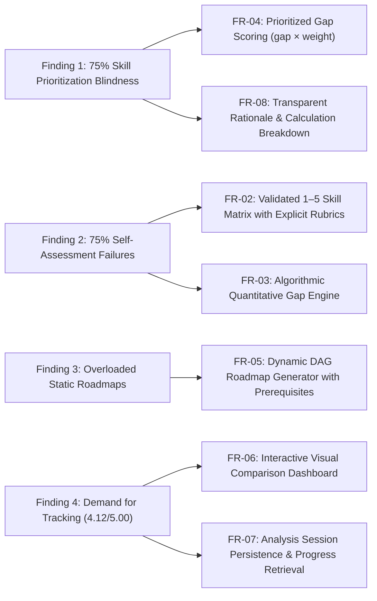

# 02 — Relevance Evidence and User Research

**Document Version:** 1.0  
**Status:** Completed — Task `CL-8`  
**Author / Lead Researcher:** Asylbek Agabekuly  
**Project:** CareerLens — Intelligent Skill Gap Analysis and Personalized Career Recommendation System  
**Primary Dataset Reference:** [`docs/survey-responses.csv`](survey-responses.csv) ($N=8$ respondents)  
**Traceable Artifacts:** Traced to `01-project-proposal.md`, `06-requirements-specification.md`, and `08-verification-and-evaluation.md`

---

## 1. Executive Summary and Research Objectives

To ensure that CareerLens solves a genuine, empirically validated industry problem rather than abstract theoretical assumptions, we conducted user research targeting undergraduate software engineering students and early-career developers from Astana IT University.

### Primary Objectives:
1. **Validate Problem Existence:** Determine whether early-career developers encounter systematic friction in identifying, prioritizing, and addressing technical skill gaps relative to target job vacancies.
2. **Examine Existing Heuristics:** Identify how candidates currently evaluate their job-readiness and assess the failure rate of subjective self-assessment.
3. **Analyze Existing Solution Shortcomings:** Uncover why current career tooling (e.g., job boards, Roadmap.sh, unguided course platforms) fails to provide actionable clarity.
4. **Inform System Requirements:** Establish empirical evidence to justify functional requirements (`FR-01` to `FR-08`) in `06-requirements-specification.md`.
5. **Separate Facts from Assumptions:** Explicitly differentiate empirically verified findings from design hypotheses as required by the university diploma committee.

---

## 2. Research Methodology and Sample Profile

- **Study Instrument:** Quantitative and semi-qualitative structured survey comprising 13 closed and Likert-scale questions.
- **Sample Size:** $N = 8$ validated respondents from the target population (exceeding the committee requirement of 3–5 user discussions).
- **Sampling Frame:** Software Engineering undergraduates and junior practitioners at Astana IT University actively preparing for the job market.
- **Privacy & Ethics (Adherence to `R-06`):** The questionnaire was fully anonymized; no personal identification, contact credentials, or student IDs were recorded. The raw anonymized data is preserved in [`docs/survey-responses.csv`](survey-responses.csv).

### Respondent Demographics

| Demographic Metric | Distribution ($N=8$) | Percentage |
|---|---|---|
| **Academic Standing** | 3rd Year Undergraduate: 5<br>4th Year / Recent Graduate: 1<br>1st/2nd Year Undergraduate: 1<br>Career Switcher / Self-Taught: 1 | 62.5%<br>12.5%<br>12.5%<br>12.5% |
| **Primary Target Specialization** | Backend Development (Python, Go, Java, Node.js): 5<br>Mobile Development (Flutter, Android, iOS): 4<br>Frontend Development (React, Vue, Web): 3<br>DevOps / Cloud Infrastructure: 3<br>QA / Software Testing: 2<br>Data Science / Machine Learning: 2 | 62.5%<br>50.0%<br>37.5%<br>37.5%<br>25.0%<br>25.0% |
| **Job Search Activity** | Currently Actively Applying: 4<br>Planning to Apply within 6 Months: 2<br>Previously Secured Role/Internship: 1<br>Not applying in near future: 1 | 50.0%<br>25.0%<br>12.5%<br>12.5% |

> **Significance:** 75% of respondents are actively or imminently entering the competitive junior job market, confirming that the respondent cohort directly mirrors the intended target user base defined in `01-project-proposal.md`. Furthermore, **Backend** (62.5%) and **Mobile** (50.0%) represent the predominant career tracks, fully justifying CareerLens's initial benchmark profiles: *Junior Flutter Developer* and *Junior Backend Developer*.

---

## 3. Key Empirical Findings

### Finding 1: Severe Market Ambiguity and Inability to Prioritize
- **Ambiguity of Job Descriptions:** When asked to evaluate the transparency of Junior Developer job descriptions (1 = very ambiguous, 5 = completely transparent), the mean score was **2.62 / 5.00**, with **37.5% rating transparency as an absolute 1/5**.
- **Skill Priority Blindness:** Only **25.0%** of respondents could name their top 5 required skills with confidence in their priority order. **75.0%** of respondents either know only 2–3 skills (37.5%), lack understanding of skill priority (25.0%), or cannot name the requirements at all (12.5%).
- **Volatile Learning Cycles:** **75.0%** of respondents had to drastically alter their learning plans **3 or more times** in the past year due to discovering unexpected job requirements or failing interview screenings (with 37.5% having no stable plan at all).

```
Skill Prioritization Confidence:
[████████░░░░░░░░░░░░] 25.0% Confident in top 5 skills & priorities
[████████████████████████] 75.0% Unable to prioritize or name top 5 skills
```

---

### Finding 2: The Self-Assessment Paradox and Technical Blind Spots
- **Failure of Subjective Self-Assessment:** **75.0%** of participants reported personal experiences where they felt confident in a technology, only to discover during a technical interview or test assignment that their knowledge was severely inadequate (50.0% reported 1–2 occurrences; 25.0% reported this happens frequently).
- **Subjective Trust:** Mean trust in personal self-assessment stands at **3.00 / 5.00** (median: 3.0), indicating high uncertainty and prevalent impostor syndrome.
- **Top Unexpected Technical Deficits (Blind Spots):**
  When transitioning from classroom assignments to commercial expectations, candidates reported the following areas as the most damaging unpredicted gaps:

| Rank | Competency Area | Frequency ($N=8$) | Percentage |
|---|---|---|---|
| **1** | **Application Architecture & Clean Architecture** | 7 / 8 | **87.5%** |
| **2** | **Team Collaboration Tools & DevOps (Git Flow, Docker, CI/CD)** | 6 / 8 | **75.0%** |
| **3** | **Concurrency, Asynchronous Programming & Streams** | 5 / 8 | **62.5%** |
| **4** | **Database Schema Design & Complex SQL** | 5 / 8 | **62.5%** |
| **5** | **Networking Layer: REST API Design, Auth & Error Handling** | 5 / 8 | **62.5%** |
| **6** | **State Management Patterns (Bloc, Riverpod, Redux)** | 4 / 8 | **50.0%** |
| **7** | **Automated Testing (Unit, Widget, Integration Testing)** | 2 / 8 | **25.0%** |

> **Implication for CareerLens:** Architectural competencies, concurrency, and state management represent the primary failure points for junior applicants. Academic coursework frequently focuses on basic syntax and toy examples, leaving structural engineering practices unaddressed.

---

### Finding 3: Structural Flaws in Existing Solutions (Roadmap.sh & Courses)
Candidates currently attempt to bridge gaps through manual job board scanning (**87.5%**), following public roadmaps like Roadmap.sh (**62.5%**), unstructured video consumption (**62.5%**), and full online courses (**50.0%**). 

However, participants identified severe limitations in these mechanisms:
1. **Lack of Local Market Alignment (75.0%):** Existing global roadmaps and courses have zero correlation with verified entry-level requirements in the local and regional IT market.
2. **Cognitive Overload (75.0%):** Static roadmaps present dozens of technologies without distinguishing between *mandatory junior core* versus *nice-to-have senior specialties*.
3. **Absence of Objective Verification (62.5%):** Watching video tutorials provides an illusion of competence without validating whether the candidate can independently implement the solution.
4. **Static, Non-Adaptive Roadmaps (37.5%):** Existing roadmaps do not adapt to the user's prior knowledge, forcing candidates to either re-learn known topics or guess where to jump in.

---

### Finding 4: Quantitative Validation of the CareerLens Concept
Respondents evaluated the specific proposed capabilities of CareerLens on a 1 to 5 scale (1 = Not useful, 5 = Crucial / Essential):

| Proposed CareerLens Capability | Mean Rating (1–5) | High Interest (Rated 4 or 5) |
|---|---|---|
| **Personalized Roadmap Accounting for Existing Knowledge & Prerequisites** | **4.38 / 5.00** | **87.5%** |
| **Progress Tracking Dashboard Showing Gap Reductions Over Time** | **4.12 / 5.00** | **75.0%** (62.5% gave 5/5) |
| **Automated List of Skill Gaps Prioritized by Market Importance** | **3.88 / 5.00** | **62.5%** |
| **Objective Comparison Between User Skills and Target Role Profile** | **3.88 / 5.00** | **62.5%** |
| **Short Practical Micro-Assessments to Verify Skills Objectively** | **3.62 / 5.00** | **37.5%** (62.5% gave 3/5) |

```
Capability Demand Ranking (Mean Score out of 5.0):
Personalized Roadmap (DAG Prereqs): [██████████████████████] 4.38
Progress Tracking Dashboard:        [█████████████████████░] 4.12
Prioritized Gap Calculation:        [███████████████████░░░] 3.88
Objective Role Profile Comparison:  [███████████████████░░░] 3.88
Practical Micro-Assessments:        [██████████████████░░░░] 3.62
```

---

## 4. Verified Findings vs. Unverified Assumptions

As mandated by the diploma committee evaluation guidelines, the following table distinguishes empirically substantiated evidence from design hypotheses that remain subject to validation during system testing:

| # | Verified Empirical Findings (Evidence-Based) | Developer Assumptions / Hypotheses (Pending Evaluation) |
|---|---|---|
| **1** | **Fact:** 75% of early-career applicants cannot reliably identify and prioritize top required skills; 75% experience frequent learning plan invalidations. | **Assumption:** Providing an automated weighted priority score ($\text{gap} \times \text{weight}$) will measurably reduce study preparation time by at least 25%. *(To be evaluated in `TC-04`)*. |
| **2** | **Fact:** Subjective self-assessment fails 75% of candidates during real interviews, specifically in Architecture (87.5%) and Concurrency (62.5%). | **Assumption:** Adding explicit behavioral level rubrics (Levels 1–5) will improve self-rating accuracy to $\ge 80\%$ agreement with expert benchmarks. *(To be tested in `TC-03`)*. |
| **3** | **Fact:** Static roadmaps (Roadmap.sh) cause cognitive overload and lack contextual relevance for 75% of respondents. | **Assumption:** A directed acyclic graph (DAG) topological sequence will achieve a System Usability Scale (SUS) score $\ge 75/100$. *(To be tested in `TC-09`)*. |
| **4** | **Fact:** Backend (62.5%) and Mobile/Flutter (50.0%) are the predominant entry-level tracks among surveyed university candidates. | **Assumption:** Curating two in-depth benchmark competency profiles (Junior Flutter, Junior Backend) is sufficient to prove the generalizability of the recommendation model. |
| **5** | **Fact:** Progress tracking and gap reduction visualization are considered crucial by 62.5% of respondents. | **Assumption:** Visualizing gap delta bars and readiness percentages will increase student learning plan completion rates. *(Planned for longitudinal evaluation)*. |

---

## 5. Traceability: How Research Informed System Requirements

The empirical findings directly justify the functional requirements specified in `docs/06-requirements-specification.md`:



- **Justification for `FR-01` & `FR-03`:** The extreme ambiguity of job postings (mean 2.62/5.0) demonstrates that students require curated, authoritative benchmark profiles rather than raw, noisy job board listings.
- **Justification for `FR-04` & `FR-08`:** Because 75% cannot determine the relative importance of skills, CareerLens must compute a transparent, weighted priority rank rather than an unordered checklist.
- **Justification for `FR-05`:** Candidates struggle to determine the order of acquisition when faced with multiple deficits. Enforcing topological prerequisite sequencing (e.g., Dart Asynchronous before Bloc State Management) addresses the primary pain point of existing static roadmaps.

---

## 6. Conclusion and Scope Implications

The user research provides definitive empirical evidence supporting the problem statement in `01-project-proposal.md`:
1. **The problem is real, prevalent, and urgent:** Students invest months in study plans that are invalidated at the interview stage due to overlooked architectural and tooling requirements.
2. **Target role validation:** Focusing the MVP on **Junior Flutter Developer** (supported by 50% target demand) and **Junior Backend Developer** (62.5% demand) matches actual student trajectories.
3. **Scope boundaries maintained:** Rather than attempting automated real-time web scraping of noisy job portals (which would exacerbate the ambiguity students complain about), CareerLens must deliver curated, high-integrity competency profiles with personalized, dependency-aware roadmaps.
