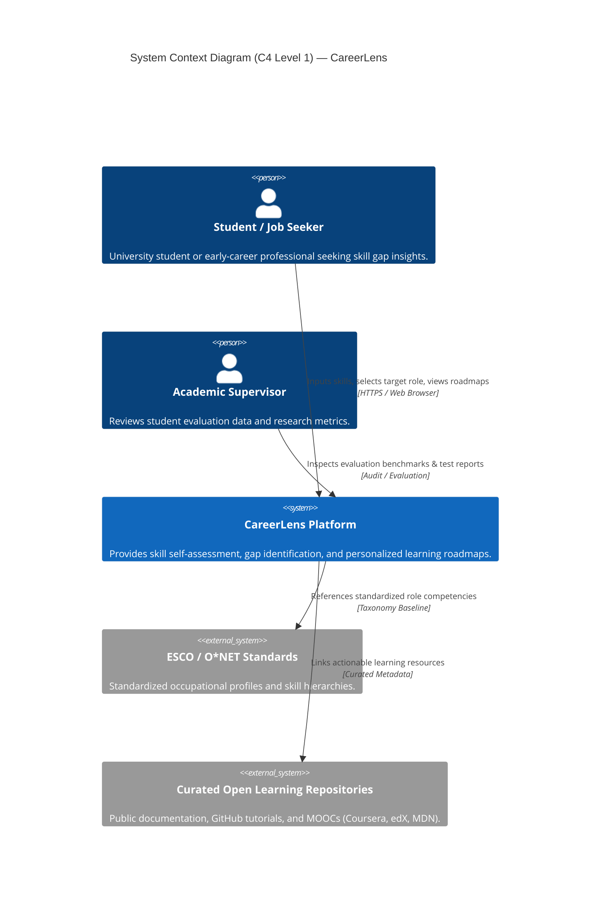
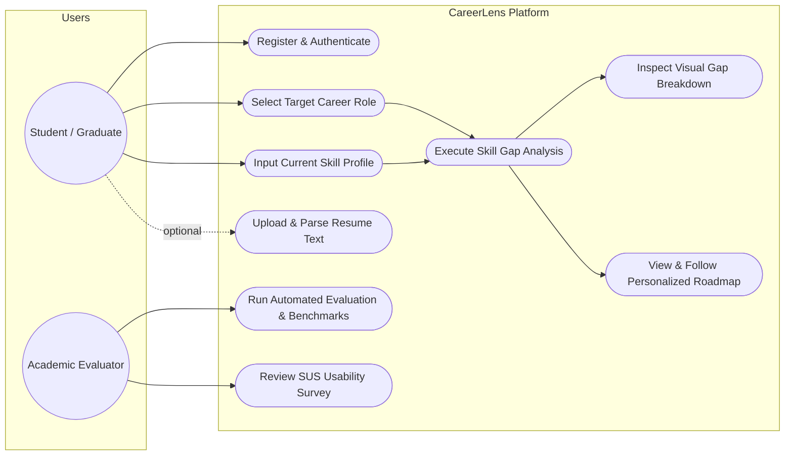
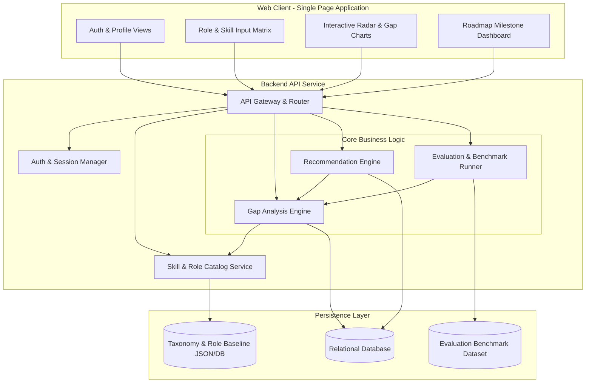

# 07 — System Architecture & Design: CareerLens

**Document Version:** 1.0  
**Date:** October 2026  
**Status:** Architectural Baseline (MVP Scope)  
**Lead Author:** Bekzat Duisenbek (System Architecture & Backend)  
**Co-Authors:** Kuanysh Assaubayev (Analytical Modules), Asylbek Agabekuly (Frontend Interfaces)  
**Academic Supervisor:** Praveen Kumar (Astana IT University)  

---

## 1. Architectural Philosophy and Scope

CareerLens prioritizes a modular, maintainable, and explainable software architecture over complex, opaque "black-box" models. For the diploma MVP, the core analytical decisions rely on deterministic heuristics grounded in standardized skill taxonomies (ESCO / O*NET), guaranteeing verifiable correctness, low runtime latency, and full transparency for academic evaluation.

---

## 2. System Context Diagram (C4 Level 1)

The C4 Context diagram illustrates how CareerLens interacts with primary users and external systems.

---

## 3. Use Case Diagram

The core user workflows of CareerLens cover authentication, profiling, analysis, and roadmap tracking:

---

## 4. Component Diagram (C4 Level 3 — Backend API & Engine)

The internal decomposition of the system emphasizes modular decoupling between data ingestion, computation, and presentation:

---

## 5. Algorithmic Foundation: Gap Computation and Prioritization

The core analytical pipeline executes deterministically in six clear steps:

1. **Role Requirement Retrieval:**  
   The user selects a target role $R$ (e.g., *Junior Backend Developer*). The system retrieves the required skills $\mathcal{S}_R = \{s_1, s_2, \dots, s_n\}$ along with their minimum required proficiency levels $\text{required}_i \in [1, 5]$ and role importance weights $\text{importance}_i \in [1, 5]$.
2. **Current Competency Mapping:**  
   The user declares their current proficiency $\text{current}_i \in [0, 5]$ for each skill (where $0$ indicates absence of knowledge).
3. **Gap Model:**  
   The skill deficiency $\text{gap}_i$ for each skill $s_i$ is computed as:
   $$\text{gap}_i = \max(0, \, \text{required}_i - \text{current}_i)$$
4. **Priority Ranking Function:**  
   To prioritize which gap should be addressed first, each gap is weighted by the importance of that skill in the target role:
   $$\text{priority}_i = \text{gap}_i \times \text{importance}_i$$
   *Example:* If SQL has $\text{current} = 1$, $\text{required} = 4$ ($\text{gap} = 3$), and $\text{importance} = 3$, its calculated priority is $3 \times 3 = 9$.
5. **Categorization:**  
   - **Critical / Missing:** $\text{gap}_i \ge 3$ or $\text{priority}_i \ge 9$.
   - **Developing / Moderate:** $1 \le \text{gap}_i \le 2$.
   - **Proficient / Met:** $\text{gap}_i = 0$.
6. **Explainable Roadmap Compilation:**  
   For each skill with $\text{gap}_i > 0$, the system attaches a curated learning action, estimated hours of study, and a direct open resource reference, ordered descending by $\text{priority}_i$.

---

## 6. Architectural Decision Records (ADRs)

### ADR-01: Explainable Rule-Based Analytical Engine for MVP
- **Status:** Accepted
- **Context:** The project requires a reliable, transparent, and verifiable method to identify skill gaps without unpredictable hallucinations or the cold-start data scarcity typical of pure collaborative filtering.
- **Decision:** Implement a deterministic mathematical heuristic ($\text{gap} \times \text{importance}$) grounded in standardized role competency matrices.
- **Consequences:** Low computational overhead, sub-second latency, deterministic testability, and full transparency during academic thesis defense.

### ADR-02: Decoupled Web Client & RESTful Backend Architecture
- **Status:** Accepted
- **Context:** Individual responsibilities divide frontend (Asylbek) and backend/data (Bekzat, Kuanysh).
- **Decision:** Adopt a decoupled architecture communicating over well-documented OpenAPI / REST endpoints with JSON payloads.
- **Consequences:** Independent development velocity, isolated testing, clear interface contracts, and reproducible API benchmarking.

### ADR-03: Grounding in International Taxonomies (ESCO & O*NET)
- **Status:** Accepted
- **Context:** Manually inventing skill lists risks personal bias and non-standard terminology.
- **Decision:** Align the role catalog with the European Commission's ESCO classification and US O*NET competency dimensions.
- **Consequences:** Scientifically defensible skill hierarchies and direct cross-referencing in academic literature.

### ADR-04: Relational Data Persistence with Migration Versioning
- **Status:** Accepted
- **Context:** The system manages structured entity relationships between Users, Roles, Skills, Assessments, and Recommendations.
- **Decision:** Utilize a relational schema (PostgreSQL / SQLite for local development) with structured schema migrations.
- **Consequences:** ACID guarantees, data integrity, and strict typing of assessment records.
