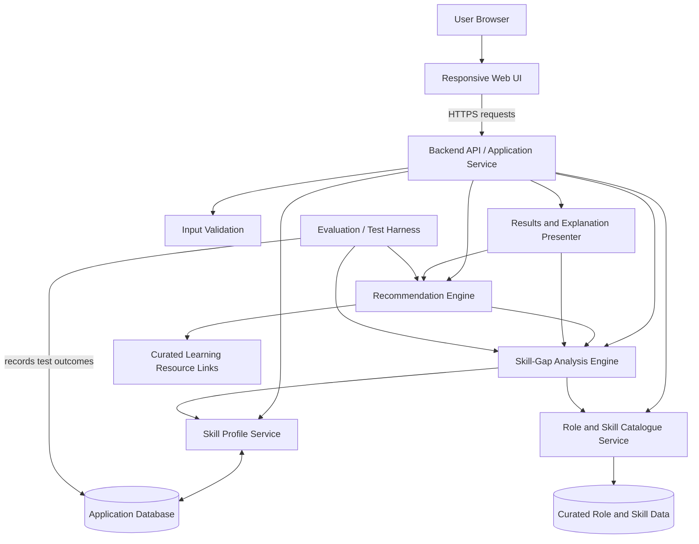

# Draft Component Diagram

## Purpose
Present the proposed internal components and their relationships. This is a logical architecture; deployment details and the final technology stack remain to be confirmed.

## Component responsibilities

| Component | Responsibility | Main inputs | Main outputs |
|---|---|---|---|
| Responsive Web UI | Collect user inputs and display analysis | Skill profile, selected role | Requests and rendered results |
| Backend API / Application Service | Coordinate requests and enforce application rules | Validated requests | Service responses |
| Input Validation | Check required fields, types, and allowed ranges | User input | Valid data or validation errors |
| Skill Profile Service | Normalize and retrieve user-declared skill levels | User skill entries | Structured profile |
| Role and Skill Catalogue Service | Provide role requirements and skill metadata | Role identifier | Required skills, target levels, importance |
| Skill-Gap Analysis Engine | Compare current and required skill levels | Profile and role requirements | Gap values and priority inputs |
| Recommendation Engine | Map high-priority gaps to learning actions | Gap list and curated links | Ranked, explainable recommendations |
| Results and Explanation Presenter | Format results with reasons and limitations | Gaps and recommendations | User-facing report |
| Evaluation / Test Harness | Run repeatable test cases and capture metrics | Fixed test profiles and reference labels | Test results and metric summaries |
| Application Database | Persist data if persistence is in scope | Profiles and catalogue records | Stored records |
| Curated Role and Skill Data | Store role definitions and skill requirements | Reviewed catalogue entries | Versioned role data |
| Curated Learning Resource Links | Supply optional learning links | Reviewed URLs and metadata | Resources attached to recommendations |

## Data flow
1. The user enters a skill profile and selects a target role in the web UI.
2. The backend validates the request and obtains the profile and role requirements.
3. The analysis engine computes per-skill gaps using the documented rule.
4. The recommendation engine maps prioritized gaps to curated learning actions.
5. The presenter returns gaps, priority, rationale, and limitations to the UI.
6. The evaluation harness runs controlled test cases separately from ordinary user workflows.

## Architecture decisions to confirm
- **Frontend:** choose one framework already familiar to the team; do not list multiple competing stacks as if all will be used.
- **Backend:** select one implementation framework based on team experience, testability, and deployment constraints.
- **Storage:** use a relational database if profiles, roles, skills, and recommendations require structured relationships; a small prototype may begin with version-controlled JSON.
- **Authentication:** defer unless user accounts and persistent personal profiles are required in the assessed MVP.
- **Recommendation method:** begin with a deterministic, explainable rules-based baseline; compare a more advanced method only if time and data permit.

## Quality and security notes
- Validate all user-provided values on the server.
- Avoid storing real CVs or unnecessary personal information in the MVP.
- Never commit credentials or private participant data.
- Version the role catalogue and test dataset so evaluation results can be reproduced.
- Treat user-declared skill levels as estimates, not independently verified facts.
