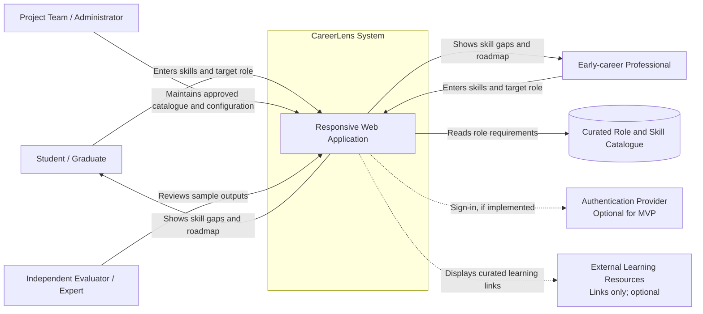

# System Context Diagram

## Purpose
Show CareerLens as one system, its human users, and external entities it may depend on.

## Actors and entities
- **Student / Graduate:** provides a self-assessed skill profile, chooses a target role, and reviews results.
- **Early-career Professional:** uses the same workflow to identify development priorities.
- **Project team / administrator:** maintains the curated role and skill catalogue for the MVP.
- **Curated role and skill catalogue:** contains role-specific required skills, target levels, importance weights, and optional references.
- **Authentication provider:** optional; include only if authentication is in the agreed MVP.
- **External learning resources:** optional curated URLs; CareerLens does not own or guarantee the content.
- **Independent evaluator / expert:** reviews a sample of skill-gap outputs using a documented rubric.

## Boundary notes
CareerLens does not guarantee employment, provide formal certification, or independently verify users' self-reported skills. External identity and learning services are optional integrations, not assumed completed dependencies.
