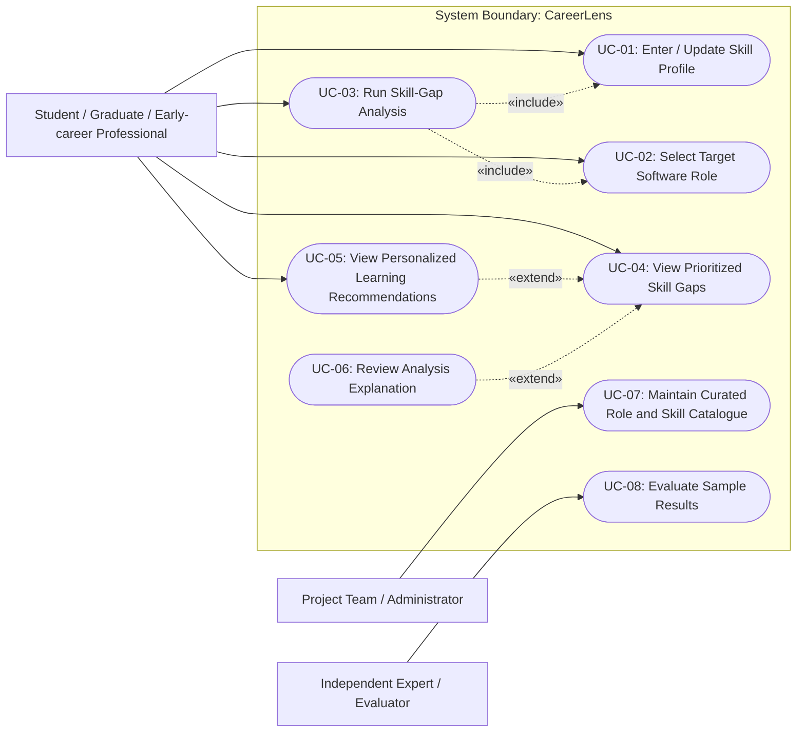

# Use Case Diagram

## Purpose
Describe the main user interactions and system functions in the proposed CareerLens MVP using formal UML Use Case concepts.

## UML Relationships & Stereotypes

- **`<<include>>` Dependencies:**
  - `UC-03 (Run Skill-Gap Analysis)` strictly **includes** `UC-01 (Enter / Update Skill Profile)` and `UC-02 (Select Target Software Role)` because a gap comparison cannot be computed without a defined skill profile and a target role profile.
- **`<<extend>>` Dependencies:**
  - `UC-05 (View Personalized Learning Recommendations)` **extends** `UC-04 (View Prioritized Skill Gaps)` when the user seeks actionable study steps for the identified gaps.
  - `UC-06 (Review Analysis Explanation)` **extends** `UC-04 (View Prioritized Skill Gaps)` when the user requests detailed reasoning ($gap \times importance$) for why a specific skill was prioritized.

---

## Main Scenarios

### UC-01 — Enter or Update Skill Profile
**Primary Actor:** User (Student / Graduate / Professional)  
**Precondition:** CareerLens web client is accessible.  
**Main Flow:**
1. The user navigates to the skill inventory matrix.
2. The user inputs their declared proficiency levels (1–5) across technical competencies.
3. The system validates entries against allowable ranges and saves the state.  
**Acceptance Criteria:** Non-numeric or out-of-range inputs trigger clear validation warnings; valid inputs are successfully prepared for analysis. (Traces to **FR-02**).

### UC-02 — Select Target Software Role
**Primary Actor:** User  
**Main Flow:**
1. The user chooses an occupational role from the curated catalog (e.g., Junior Backend Developer).
2. The system loads the associated required skills, minimum competency thresholds, and importance weights.  
**Acceptance Criteria:** Only approved catalog roles are selectable; role competencies are loaded dynamically. (Traces to **FR-01**).

### UC-03 — Run Skill-Gap Analysis
**Primary Actor:** User  
**Main Flow:**
1. The user initiates analysis.
2. The system evaluates the difference between declared and required proficiency using the heuristic: $gap_i = \max(0, required_i - current_i)$.
3. The system computes priorities: $priority_i = gap_i \times importance_i$.  
**Acceptance Criteria:** Deterministic, reproducible gap outputs produced within target latency ($\le 2.5$ s). (Traces to **FR-03**, **FR-04**, **NFR-01**).

### UC-04 — View Prioritized Skill Gaps
**Primary Actor:** User  
**Main Flow:**
1. The system presents the ranked gap list, categorizing competencies into Critical Gaps, Moderate Gaps, and Met Competencies.
2. Visual charts (competency radar/bar) illustrate the delta.  
**Acceptance Criteria:** Gaps are strictly sorted descending by priority score. (Traces to **FR-04**, **FR-06**).

### UC-05 — View Personalized Learning Recommendations
**Primary Actor:** User  
**Main Flow:**
1. The system matches prioritized gaps with curated open learning resources (documentation, tutorials, courses).
2. A structured, sequential learning roadmap is displayed.  
**Acceptance Criteria:** Every recommended resource links directly to an identified gap. (Traces to **FR-05**).

### UC-06 — Review Analysis Explanation
**Primary Actor:** User  
**Main Flow:**
1. The user clicks on any prioritized gap item.
2. The system reveals the mathematical rationale and requirement depth context.  
**Acceptance Criteria:** Full transparency into why a skill is recommended ahead of others. (Traces to **FR-04**, **NFR-02**).

### UC-07 — Maintain Curated Role and Skill Catalogue
**Primary Actor:** Administrator (Project Team)  
**Main Flow:**
1. Authorized team members update occupational roles, skill mappings, importance weights, or learning URLs in the structured catalog.
2. The system validates schema integrity.  
**Acceptance Criteria:** Dynamic role configuration without hardcoding or recompilation. (Traces to **NFR-04**).

### UC-08 — Evaluate Sample Results
**Primary Actor:** Independent Expert / Academic Evaluator  
**Main Flow:**
1. Evaluator reviews generated skill gaps and roadmaps against benchmark reference cases using a standardized rubric.
2. Disagreements and agreement scores are recorded.  
**Acceptance Criteria:** Benchmark reproducibility without manual intervention. (Traces to Evaluation Plan).

---

## MVP Exclusions
Unsupervised live job-board scraping, resume parsing via generative AI without validation, native mobile apps, and automated employment guarantees are strictly excluded from the initial MVP scope.
