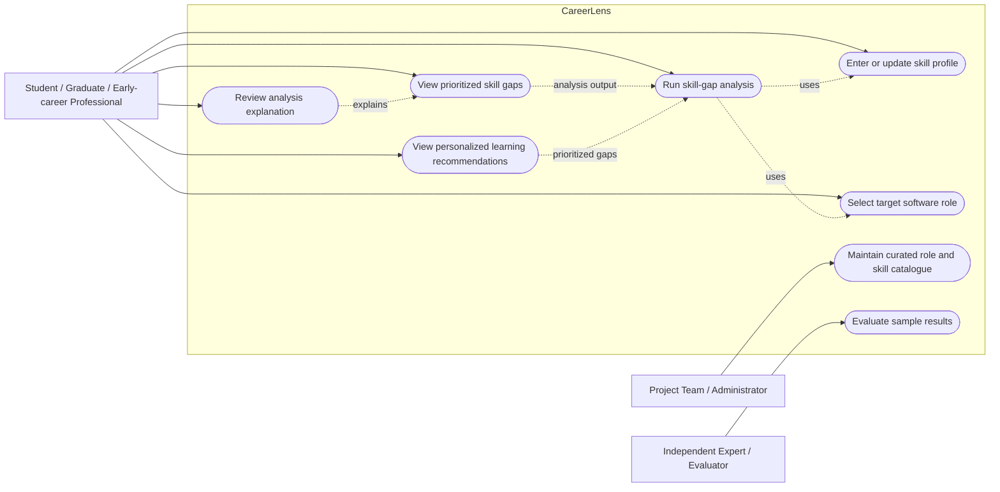

# Use Case Diagram

## Purpose
Describe the main user interactions in the proposed CareerLens MVP.

## Main scenarios

### UC-01 — Enter skill profile
**Primary actor:** User  
**Precondition:** CareerLens is available.  
**Main flow:** The user enters skills and self-assessed levels; the system validates the values and identifies missing or invalid inputs.  
**Postcondition:** A valid skill profile is available for analysis.  
**Acceptance:** Invalid values are rejected with a clear message; valid values are retained for the current workflow.

### UC-02 — Select target role
**Primary actor:** User  
**Main flow:** The user chooses a role from the curated catalogue; the system displays or uses the role's required skills and target levels.  
**Acceptance:** Only roles available in the MVP catalogue can be selected.

### UC-03 — Run skill-gap analysis
**Primary actor:** User  
**Main flow:** The system compares the user's current levels with the selected role's required levels and computes a gap for each relevant skill.  
**Acceptance:** For the defined test dataset, the returned gaps match the expected reference results.

### UC-04 — Review prioritized gaps
**Primary actor:** User  
**Main flow:** The system sorts gaps by the documented priority rule and explains why each skill is important.  
**Acceptance:** The order and rationale follow the documented algorithm and are reproducible for the same input.

### UC-05 — View learning recommendations
**Primary actor:** User  
**Main flow:** The system maps the most important gaps to curated learning actions or resources.  
**Acceptance:** Every recommendation is connected to at least one identified gap and has a stated rationale.

### UC-06 — Maintain catalogue
**Primary actor:** Project team / administrator  
**Main flow:** An authorized team member updates role requirements, skill levels, importance weights, and resource references.  
**Acceptance:** Catalogue changes are validated and documented. A separate admin interface is optional; manual configuration may be used during the prototype stage.

### UC-07 — Evaluate sample results
**Primary actor:** Independent expert / evaluator  
**Main flow:** The evaluator reviews a predefined sample using an agreed rubric and records agreement or relevance scores.  
**Acceptance:** The dataset, rubric, reviewer procedure, and results are documented without presenting planned results as achieved results.

## MVP exclusions
Resume upload and parsing, job-board scraping, live labour-market prediction, automated employment decisions, and mandatory third-party authentication are excluded unless explicitly approved as requirements.
