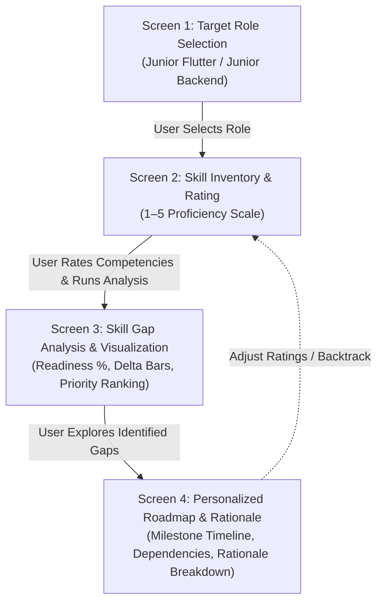

# CareerLens — UX Prototype and Interaction Specifications

**Document Version:** 1.0  
**Status:** Completed — Task `CL-10`  
**Author / UX Designer:** Asylbek Agabekuly  
**Project:** CareerLens — Intelligent Skill Gap Analysis and Personalized Career Recommendation System  
**Deliverable File:** [`prototype/index.html`](index.html) (Interactive Clickable Prototype)

---

## 1. Overview and Purpose

This prototype demonstrates the key user journeys, interaction patterns, visual hierarchy, and algorithm transparency of the **CareerLens** web application. 

In accordance with the diploma project requirements (Stage 1 / Pre-Defense 1):
- A complete production backend is not required at this phase.
- The prototype must clearly demonstrate how target users interact with the solution, input competencies, view quantified skill gaps, and explore prioritized learning roadmaps.

---

## 2. Interactive Prototype Access

The functional, standalone interactive prototype is implemented in [`prototype/index.html`](index.html).

### How to Run:
- **Zero dependencies required:** Does not require `node.js`, `npm`, or external servers.
- **Simply open in any browser:** Double-click [`prototype/index.html`](index.html) or open it directly in Google Chrome, Safari, Microsoft Edge, or Firefox.

### Key Interactive Features Implemented:
1. **Interactive Role Selection (`UC-02`, `FR-01`):** Toggle between benchmark profiles (*Junior Flutter Developer* and *Junior Backend Developer*).
2. **Skill Inventory & Rating Matrix (`UC-01`, `FR-02`):** Interactive 1–5 Likert scale buttons with instant persona pre-fill helpers (*"Typical 3rd Year Student"* vs. *"Prepared Graduate"*).
3. **Deterministic Gap Calculation Engine (`UC-03`, `FR-03`):** Dynamic client-side execution of the official baseline formula:
   $$\text{gap} = \max\left(0, \text{required} - \text{current}\right)$$
   $$\text{priority} = \text{gap} \times \text{weight}$$
4. **Visual Comparison Dashboard (`UC-04`, `FR-04`, `FR-06`):**
   - Readiness Match percentage indicator.
   - Dual-color progress bars showing current proficiency (Blue) versus required market deficit (Red/Amber).
5. **Personalized Learning Roadmap (`UC-05`, `FR-05`):**
   - Sequenced timeline respecting prerequisite dependencies.
   - Transparent rationale box explaining the exact arithmetic priority score for every study milestone (`FR-08`).

---

## 3. End-to-End User Flow (Screen Progression)

The interaction model follows a focused 4-step progressive disclosure wizard:

---

## 4. Detailed Screen Specifications and Wireframes

### Screen 1: Target Role Selection (`UC-02`)
- **Primary Objective:** Allow users to choose their career trajectory from verified benchmark competencies.
- **Key Elements:**
  - Search/filter bar for occupational roles.
  - Role overview cards showing role title, competency count, entry-level difficulty badge, and summary description.
  - Primary call-to-action: *"Continue to Skill Rating →"*.

### Screen 2: Skill Inventory and Input Matrix (`UC-01`)
- **Primary Objective:** Elicit the user's declared knowledge without cognitive overload.
- **Anchor Rubric Definition:**
  - **Level 1 (Novice):** Purely theoretical familiarity; requires direct supervision.
  - **Level 2 (Beginner):** Basic syntax and simple exercises; struggles with independent architecture.
  - **Level 3 (Competent):** Autonomous implementation of standard features; entry-level market benchmark.
  - **Level 4 (Advanced):** In-depth knowledge of internals, performance tuning, and edge cases.
  - **Level 5 (Expert / Lead):** Architectural design, mentoring, and framework-level contributions.
- **Interaction Rules:**
  - 1–5 radio buttons with visual active states.
  - Validation ensures all required role competencies have assigned ratings prior to calculation (`FR-02`).

### Screen 3: Gap Analysis and Comparison Dashboard (`UC-03`, `UC-04`)
- **Primary Objective:** Deliver an immediate, objective diagnosis of deficits.
- **Visual Structure:**
  - **Readiness Metric Card:** Percentage of total competency requirements satisfied.
  - **Critical Gap Count:** Identifies skills with deficits $\ge 2$ levels.
  - **Estimated Study Weeks:** Sum of targeted learning durations.
  - **Dual-Tone Progress Bars:** Blue segment indicates current skill level; Amber/Red segment visualizes the missing delta up to target.

### Screen 4: Personalized Learning Roadmap (`UC-05`, `UC-06`)
- **Primary Objective:** Transform identified deficits into an actionable, sequenced learning journey.
- **Dependency & Ordering Logic:**
  - Critical foundational concepts (e.g., Dart Asynchronous programming) precede framework-level applications (e.g., Bloc State Management).
  - Each milestone card displays:
    1. Milestone title and focus area.
    2. Estimated completion time.
    3. Actionable study guidance.
    4. Mathematical explanation box displaying: $\text{gap} \times \text{weight} = \text{priority}$.

---

## 5. Design System and Usability Foundations

| Token Category | Specification / Value | Justification |
|---|---|---|
| **Primary Theme** | Dark Slate (`#0b0f19`, Surface: `#111827`) | Modern developer tooling aesthetic; reduces eye strain during prolonged analysis. |
| **Accent Primary** | Royal Blue (`#3b82f6`, Hover: `#2563eb`) | High contrast against dark background; indicates primary action pathways. |
| **Semantic Signals** | Success (`#10b981`), Warning (`#f59e0b`), Critical Gap (`#ef4444`) | Familiar status indicators; allows immediate visual triage of severe deficits. |
| **Typography** | Sans-Serif: *Plus Jakarta Sans* Monospace: *JetBrains Mono* | Clean geometric legibility for UI text; distinct tabular numbers for calculations. |
| **Target Accessibility** | WCAG 2.1 AA Compliance | Contrast ratio $> 4.5:1$ on all interactive text elements and controls. |

---

## 6. Target User Personas

### Persona A: Alikhan (Primary Target User)
- **Profile:** 3rd-year Software Engineering student at Astana IT University.
- **Background:** Completed core OOP and Mobile Development courses; knows basic Flutter widgets and Dart syntax.
- **Goal:** Secure a Summer 2027 Junior Flutter Developer internship.
- **Pain Point:** Has applied to 12 vacancies on LinkedIn/hh.kz without interviews. Does not understand why knowing basic Flutter is insufficient.
- **Prototype Journey:** Selects *Junior Flutter Developer* $\rightarrow$ Discovers severe gap in *State Management (Bloc)* and *Asynchronous Streams* $\rightarrow$ Obtains prioritized 7-week study roadmap.

### Persona B: Diana (Secondary Target User)
- **Profile:** Recent graduate with Python data analysis background wanting to transition to Backend API development.
- **Goal:** Transition to Junior Backend Engineer.
- **Pain Point:** Overwhelmed by massive roadmaps containing 50+ tools; does not know which 4–5 core tools are essential for junior positions.
- **Prototype Journey:** Selects *Junior Backend Developer* $\rightarrow$ Learns that Docker basics and relational PostgreSQL design outweigh obscure cloud tools for junior roles.

---

## 7. Usability Evaluation Plan (`NFR-02` Traceability)

The prototype will be evaluated in accordance with `08-verification-and-evaluation.md` using the **System Usability Scale (SUS)**:
1. **Sample Cohort:** 15 representative students from Astana IT University.
2. **Evaluation Tasks:**
   - Task 1: Complete role selection within 30 seconds.
   - Task 2: Input skill ratings and execute analysis without external instructions.
   - Task 3: Accurately explain why the top-ranked skill gap was prioritized first.
3. **Success Criteria:** Average SUS Score $\ge 75/100$ and 100% completion rate without facilitator intervention.
